<!--
  README de perfil do GitHub (github.com/korflux).
  Todas as imagens saem de scripts/build-assets.mjs (npm run build); não edite assets/ à mão.
  Cada peça usa <picture> para seguir o tema claro/escuro do GitHub. O hero é único.
  Os textos das imagens vivem no gerador; os `alt` e os links de texto abaixo repetem o essencial.
-->

  <a href="https://korflux.com.br/"></a>

  <picture>
    <source media="(prefers-color-scheme: dark)" srcset="assets/terminal-dark.svg" />
    
  </picture>

 

<!-- ───────────── 01 / projetos ───────────── -->
<picture>
  <source media="(prefers-color-scheme: dark)" srcset="assets/section-projetos-dark.svg" />
  
</picture>

  <a href="https://github.com/korflux/aion-bots"><picture>
      <source media="(prefers-color-scheme: dark)" srcset="assets/card-aion-dark.svg" />
      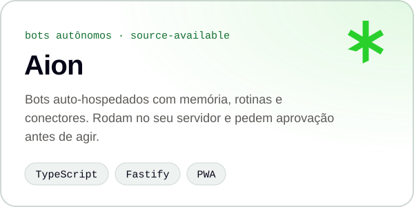
    </picture></a>
  <a href="https://github.com/korflux/vibeflow"><picture>
      <source media="(prefers-color-scheme: dark)" srcset="assets/card-vibeflow-dark.svg" />
      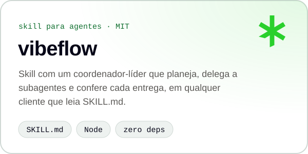
    </picture></a>

  <a href="https://github.com/korflux/kastir-oss"><picture>
      <source media="(prefers-color-scheme: dark)" srcset="assets/card-kastir-dark.svg" />
      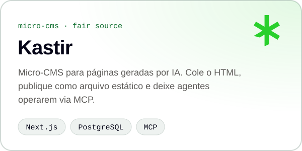
    </picture></a>
  <a href="https://github.com/korflux/movia"><picture>
      <source media="(prefers-color-scheme: dark)" srcset="assets/card-movia-dark.svg" />
      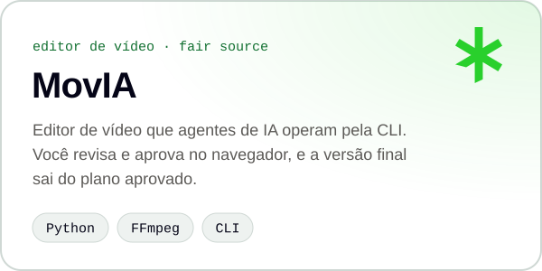
    </picture></a>

  <a href="https://github.com/korflux/aion-bots"><b>aion-bots</b></a> ·
  <a href="https://github.com/korflux/vibeflow"><b>vibeflow</b></a> ·
  <a href="https://github.com/korflux/kastir-oss"><b>kastir-oss</b></a> ·
  <a href="https://github.com/korflux/movia"><b>movia</b></a>

 

<!-- ───────────── 02 / stack ───────────── -->
<picture>
  <source media="(prefers-color-scheme: dark)" srcset="assets/section-stack-dark.svg" />
  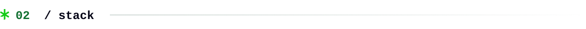
</picture>

  <picture>
    <source media="(prefers-color-scheme: dark)" srcset="assets/stack-dark.svg" />
    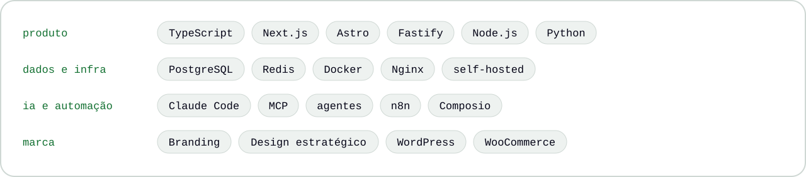
  </picture>

 

<!-- ───────────── 03 / contato ───────────── -->
<picture>
  <source media="(prefers-color-scheme: dark)" srcset="assets/section-contato-dark.svg" />
  
</picture>

  <a href="https://korflux.com.br/"><picture>
      <source media="(prefers-color-scheme: dark)" srcset="assets/link-site-dark.svg" />
      
    </picture></a>
  &nbsp;
  <a href="https://wa.me/5511989266632"><picture>
      <source media="(prefers-color-scheme: dark)" srcset="assets/link-whatsapp-dark.svg" />
      
    </picture></a>
  &nbsp;
  <a href="https://br.linkedin.com/in/marco-kormoczi"><picture>
      <source media="(prefers-color-scheme: dark)" srcset="assets/link-linkedin-dark.svg" />
      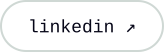
    </picture></a>
  &nbsp;
  <a href="https://www.instagram.com/korflux/"><picture>
      <source media="(prefers-color-scheme: dark)" srcset="assets/link-instagram-dark.svg" />
      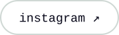
    </picture></a>
  &nbsp;
  <a href="https://www.behance.net/marcokormoczi"><picture>
      <source media="(prefers-color-scheme: dark)" srcset="assets/link-behance-dark.svg" />
      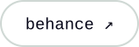
    </picture></a>

  <picture>
    <source media="(prefers-color-scheme: dark)" srcset="assets/footer-dark.svg" />
    
  </picture>

